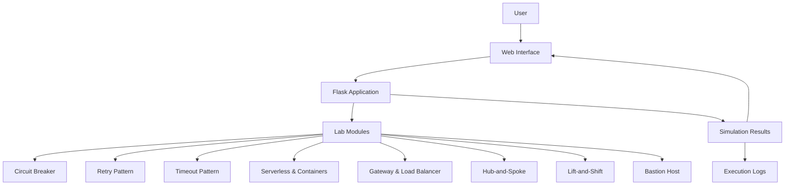

# ☁️ Cloud Architecture & Design Patterns Lab

<p align="center">

  <strong>An Interactive Laboratory for Cloud Architecture, Distributed Systems and Design Patterns</strong>

  <br/>

  Explore, simulate and understand how modern cloud systems are designed, communicate, recover from failures and scale.

</p>

---

## 🌐 About the Project

**Cloud Architecture & Design Patterns Lab** is an interactive educational web application developed to explore and demonstrate fundamental cloud architecture patterns through practical simulations.

The project transforms theoretical cloud concepts into interactive experiences, allowing users to experiment with distributed system behaviors, infrastructure models, networking architectures, security mechanisms and cloud migration strategies.

Through a web-based interface, each laboratory combines conceptual explanations, architecture visualizations, configurable scenarios, simulation results and execution logs.

> 💡 The goal is to understand not only what an architecture pattern is, but also how it works, why it is used and what problem it solves.

---

## 🎯 Project Objectives

- Understand fundamental cloud architecture principles and design patterns.
- Explore fault tolerance and resilience in distributed systems.
- Simulate failure scenarios and recovery mechanisms.
- Compare serverless computing and container-based architectures.
- Understand API routing, reverse proxies and load balancing.
- Visualize network connectivity using Hub-and-Spoke architectures.
- Explore cloud migration strategies such as Lift-and-Shift.
- Understand secure access to private infrastructure.
- Provide an interactive environment for experimenting with cloud concepts.

---

## 🧪 Architecture Labs

The platform includes eight interactive laboratories organized around different areas of cloud architecture.

<table>
<tr>
<td width="50%">

### 🛡️ Resilience & Fault Tolerance

**01 · Circuit Breaker**

Prevents continuous requests to failing services by temporarily blocking calls and allowing controlled recovery.

**02 · Retry Pattern**

Handles transient failures by retrying operations according to configurable policies.

**03 · Timeout Pattern**

Defines maximum waiting times for operations to prevent indefinite requests.

</td>
<td width="50%">

### ☁️ Cloud Infrastructure

**04 · Serverless & Containers**

Explores event-driven execution, serverless workloads and containerized applications using AWS Lambda, Docker and Amazon ECS.

</td>
</tr>

<tr>
<td width="50%">

### 🌐 Networking & Communication

**05 · API Gateway, Load Balancer & Reverse Proxy**

Explores request routing, entry points, traffic distribution and reverse proxy behavior.

**06 · Hub-and-Spoke Architecture**

Centralizes network connectivity between multiple independent networks through a shared hub.

</td>
<td width="50%">

### 🚀 Cloud Migration & Security

**07 · Lift-and-Shift Migration**

Represents the migration of existing workloads to cloud infrastructure with minimal architectural changes.

**08 · Bastion Host**

Demonstrates controlled administrative access to private infrastructure through a secure entry point.

</td>
</tr>
</table>

---

## 🗺️ Laboratory Overview

| # | Laboratory | Category | Main Concept |
|:--:|---|---|---|
| 01 | Circuit Breaker | Resilience | Failure detection and recovery |
| 02 | Retry Pattern | Resilience | Retry policies and transient errors |
| 03 | Timeout Pattern | Resilience | Request time limits |
| 04 | Serverless & Containers | Infrastructure | Lambda, Docker and ECS |
| 05 | API Gateway, Load Balancer & Reverse Proxy | Networking | Routing and traffic distribution |
| 06 | Hub-and-Spoke Architecture | Networking | Centralized network connectivity |
| 07 | Lift-and-Shift Migration | Cloud Migration | Workload rehosting |
| 08 | Bastion Host | Security | Controlled access to private servers |

---

## ✨ Key Features

- **Interactive laboratories** — Explore each architecture pattern through practical simulations.
- **Architecture visualization** — Understand component relationships and communication flows.
- **Configurable scenarios** — Experiment with different parameters and behaviors.
- **Simulation execution** — Run demonstrations directly from the web interface.
- **Execution logs** — Observe system events and simulation outcomes.
- **Educational explanations** — Understand the purpose, functionality and use cases of each pattern.
- **Local execution** — Run the application without requiring AWS infrastructure.
- **Modular implementation** — Each laboratory has its own simulation logic.

---

## 🏗️ Application Architecture

The application follows a simple modular architecture, separating the web interface, application routing and individual laboratory implementations.



### Technology Architecture

| Layer | Technology | Responsibility |
|---|---|---|
| Frontend | HTML5 | Application structure |
| Frontend | CSS3 | Interface styling and layout |
| Frontend | JavaScript | User interactions and dynamic behavior |
| Backend | Python | Simulation logic and application functionality |
| Web Framework | Flask | HTTP routes and web application |
| Simulation Modules | Python | Individual architecture pattern demonstrations |

---

## 🛠️ Technology Stack

### Backend

<p>

**Python** · **Flask**

</p>

- Python — Simulation logic and backend functionality.
- Flask — Lightweight web framework for application routing and server-side functionality.

### Frontend

<p>

**HTML5** · **CSS3** · **JavaScript**

</p>

- HTML5 — Web interface structure.
- CSS3 — Visual design, layout and responsive styling.
- JavaScript — Interactivity and simulation controls.

### Cloud & Infrastructure Concepts

<p>

**Amazon Web Services (AWS)** · **Docker** · **Distributed Systems**

</p>

- AWS Lambda
- Amazon ECS
- Docker Containers
- Amazon API Gateway
- Elastic Load Balancing
- Amazon VPC
- AWS Transit Gateway
- Amazon EC2
- Cloud Migration
- Network Security

---

## 📂 Project Structure

```text
cloud-architecture-patterns-lab/
│
├── app.py                         # Flask application entry point
├── requirements.txt                 # Python dependencies
├── README.md                       # Project documentation
├── .gitignore                      # Git ignored files
│
├── templates/                       # HTML templates
│   ├── index.html                   # Main dashboard
│   └── lab.html                     # Laboratory interface
│
├── static/                           # Static frontend resources
│   ├── css/
│   │   └── style.css                 # Application styles
│   │
│   ├── js/
│   │   └── app.js                    # Frontend interactions
│   │
│   └── images/                       # Images and visual resources
│
├── labs/                              # Simulation modules
│   ├── circuit_breaker.py
│   ├── retry_pattern.py
│   ├── timeout_pattern.py
│   ├── serverless_container.py
│   ├── gateway_proxy_balancer.py
│   ├── hub_spoke.py
│   ├── lift_shift.py
│   └── bastion_host.py
│
├── diagrams/                           # Architecture diagrams
│
└── evidence/                            # Project evidence
    ├── screenshots/                     # Application screenshots
    └── logs/                            # Simulation logs
```

---

## 🚀 Getting Started

Follow these steps to run the laboratory locally.

### Prerequisites

Make sure you have installed:

- [Python 3.10+](https://www.python.org/downloads/)
- pip
- [Git](https://git-scm.com/)

### 1. Clone the Repository

```bash
git clone https://github.com/vnheredia/cloud-architecture-patterns-lab.git
```

### 2. Navigate to the Project Directory

```bash
cd cloud-architecture-patterns-lab
```

### 3. Create a Virtual Environment

**Windows**

```bash
python -m venv venv
```

Activate the environment:

```bash
.\venv\Scripts\Activate
```

**Linux / macOS**

```bash
python3 -m venv venv
```

Activate the environment:

```bash
source venv/bin/activate
```

### 4. Install Dependencies

```bash
pip install -r requirements.txt
```

### 5. Run the Application

```bash
python app.py
```

### 6. Access the Laboratory

Open your browser and navigate to:

```text
http://127.0.0.1:5000
```

---

## 🎮 How to Use

1. Launch the application.
2. Access the main laboratory dashboard.
3. Select the architecture pattern you want to explore.
4. Read its explanation and review the architecture diagram.
5. Configure the available simulation parameters.
6. Run the simulation.
7. Analyze the results and execution logs.
8. Reset the scenario and experiment with different configurations.

---

## 📚 Educational Modules

### 01 · Circuit Breaker

<details>
<summary><strong>Explore the resilience mechanism</strong></summary>

Designed to prevent applications from repeatedly calling an unhealthy service.

The pattern introduces a circuit state mechanism that can interrupt requests when failures reach a defined condition, helping protect dependent components.

**Concepts explored:**

- Failure detection
- Circuit states
- Service protection
- Recovery mechanisms
- Fault isolation

</details>

### 02 · Retry Pattern

<details>
<summary><strong>Explore retry strategies</strong></summary>

Demonstrates how applications can retry failed operations when errors are temporary.

**Concepts explored:**

- Transient failures
- Retry attempts
- Retry limits
- Recovery behavior
- Resilience strategies

</details>

### 03 · Timeout Pattern

<details>
<summary><strong>Explore request time limits</strong></summary>

Demonstrates how timeout configurations prevent applications from waiting indefinitely for a response.

**Concepts explored:**

- Request deadlines
- Response delays
- Timeout handling
- Resource protection
- Failure management

</details>

### 04 · Serverless & Containers

<details>
<summary><strong>Explore cloud execution models</strong></summary>

Introduces serverless computing and containerized workloads through AWS Lambda, Docker and Amazon ECS.

**Concepts explored:**

- Event-driven execution
- Serverless computing
- Containerization
- Container orchestration
- Workload execution models

</details>

### 05 · API Gateway, Load Balancer & Reverse Proxy

<details>
<summary><strong>Explore request routing and traffic management</strong></summary>

Illustrates how incoming requests can be managed, routed and distributed across application services.

**Concepts explored:**

- API entry points
- Request routing
- Reverse proxy behavior
- Load balancing
- Traffic distribution

</details>

### 06 · Hub-and-Spoke Architecture

<details>
<summary><strong>Explore centralized network connectivity</strong></summary>

Represents a network architecture in which multiple independent networks communicate through a centralized hub.

**Concepts explored:**

- Network segmentation
- Centralized connectivity
- Spoke networks
- Routing
- Network scalability

</details>

### 07 · Lift-and-Shift Migration

<details>
<summary><strong>Explore workload migration</strong></summary>

Simulates moving an existing application or workload from an on-premises environment to cloud infrastructure while preserving its fundamental architecture.

**Concepts explored:**

- Cloud migration
- Rehosting
- On-premises infrastructure
- Migration planning
- Infrastructure transition

</details>

### 08 · Bastion Host

<details>
<summary><strong>Explore secure administrative access</strong></summary>

Demonstrates the use of a controlled entry point for administrators who need access to resources located inside private network environments.

**Concepts explored:**

- Private infrastructure
- Administrative access
- Network isolation
- Access control
- Security boundaries

</details>

---

## ☁️ AWS Conceptual Mapping

The laboratories are associated with AWS services and architectural concepts to connect theoretical simulations with real cloud implementations.

| Laboratory | AWS Services / Concepts | Purpose |
|---|---|---|
| Circuit Breaker | AWS Step Functions, DynamoDB, application-level resilience | Failure handling and state management |
| Retry Pattern | AWS SDK retry strategies, Step Functions | Recovering from transient errors |
| Timeout Pattern | AWS Lambda timeouts, API Gateway integration timeouts | Limiting execution and waiting time |
| Serverless & Containers | AWS Lambda, Amazon ECS, Docker | Running serverless and containerized workloads |
| API Gateway / LB / Proxy | Amazon API Gateway, Elastic Load Balancing | Routing and distributing requests |
| Hub-and-Spoke | Amazon VPC, AWS Transit Gateway, VPN | Connecting multiple networks |
| Lift-and-Shift | Amazon EC2, migration and rehosting strategies | Moving existing workloads to AWS |
| Bastion Host | Amazon EC2, VPC, public/private subnets, Security Groups | Controlled access to private resources |

> **Note:** The AWS services listed represent conceptual mappings and possible implementations. The laboratories themselves execute local simulations and do not automatically provision AWS resources.

---

## 🔎 Simulation Scope

This project is designed as an educational environment for understanding architecture patterns and their behavior.

| Feature | Scope |
|---|---|
| Simulation execution | Local environment |
| Backend processing | Python |
| Web interface | Browser-based |
| Architecture diagrams | Educational representations |
| Execution logs | Generated by local simulations |
| AWS infrastructure | Not provisioned |
| Cloud deployment | Not required |
| Cloud metrics | Simulated, not real AWS metrics |

---

## ⚠️ Limitations

- Simulations run locally and do not create real cloud infrastructure.
- AWS services are represented for educational purposes.
- Network diagrams are conceptual representations.
- Simulation outputs depend on the configured parameters and implemented logic.
- The project does not replace production deployment, infrastructure testing or cloud monitoring.
- Simulated results should not be interpreted as real AWS performance measurements.

---

## 🔮 Future Improvements

Potential extensions for the laboratory include:

- [ ] Interactive architecture diagrams.
- [ ] More configurable simulation scenarios.
- [ ] Advanced fault injection.
- [ ] Exponential backoff retry strategies.
- [ ] Circuit breaker state visualization.
- [ ] Additional load-balancing algorithms.
- [ ] Request lifecycle visualization.
- [ ] Exportable simulation reports and logs.
- [ ] Automated testing for simulation modules.
- [ ] Docker-based application deployment.
- [ ] Real AWS implementation examples.
- [ ] Cloud deployment support.

---

## 📖 References & Learning Resources

The project is based on cloud architecture principles, distributed systems concepts and AWS documentation.

- [AWS Well-Architected Framework](https://docs.aws.amazon.com/wellarchitected/latest/framework/welcome.html)
- [AWS Architecture Center](https://aws.amazon.com/architecture/)
- [AWS Prescriptive Guidance](https://docs.aws.amazon.com/prescriptive-guidance/)
- [AWS Lambda Documentation](https://docs.aws.amazon.com/lambda/)
- [Amazon ECS Documentation](https://docs.aws.amazon.com/ecs/)
- [Amazon VPC Documentation](https://docs.aws.amazon.com/vpc/)
- [Amazon EC2 Documentation](https://docs.aws.amazon.com/ec2/)

---

## 👩‍💻 Author

**Vanessa Heredia**

Cloud Architecture & Design Patterns Lab  
Educational project focused on cloud architecture, distributed systems and design patterns.

GitHub: [@vnheredia](https://github.com/vnheredia)

---

## 📄 License

This project was developed for educational purposes.

See the [`LICENSE`](LICENSE) file for additional information, if available.

---

<p align="center">
  <strong>Learn · Simulate · Understand · Design</strong>
  <br/>
  Exploring the foundations of modern cloud architectures.
</p>
